# Industrial HMI Copilot

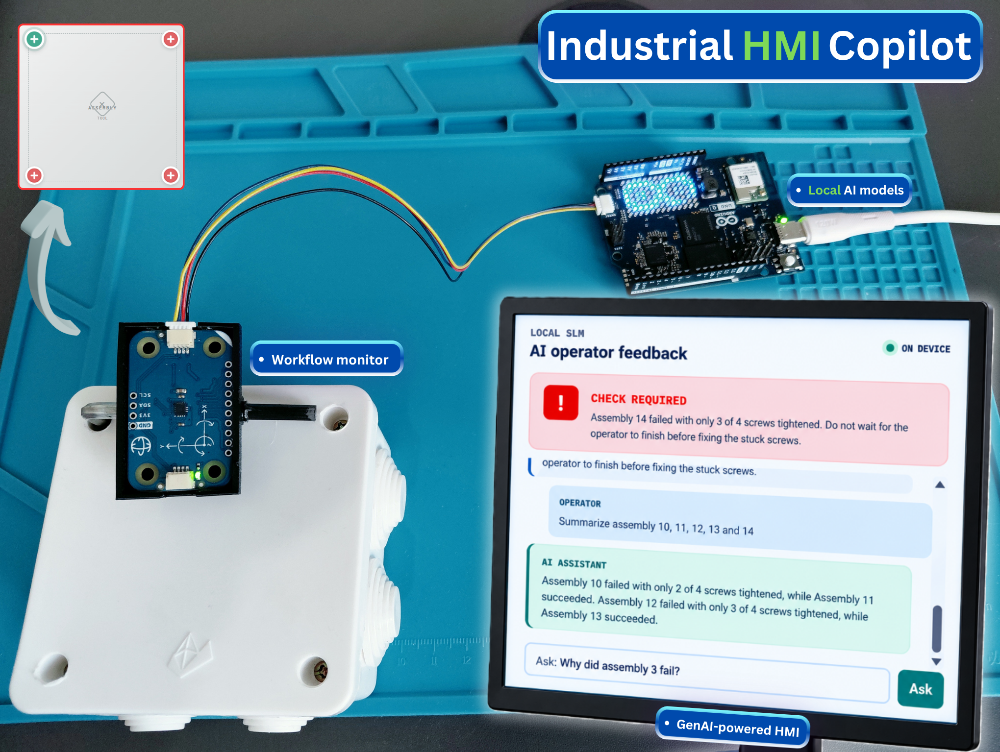

This is a [generative-AI powered Human-Machine Interface (HMI)](https://docs.edgeimpulse.com/projects/expert-network/industrial-hmi-copilot) that runs entirely on an Arduino UNO Q. A tiny motion classifier monitors a hand tool, a state machine tracks screw-tightening assemblies and a local Small Language Model explains what happened and answers operator's questions.

Tool motion classification model: [Tool motion classification - UNO Q](https://studio.edgeimpulse.com/public/1160907/latest) on Edge Impulse Studio.

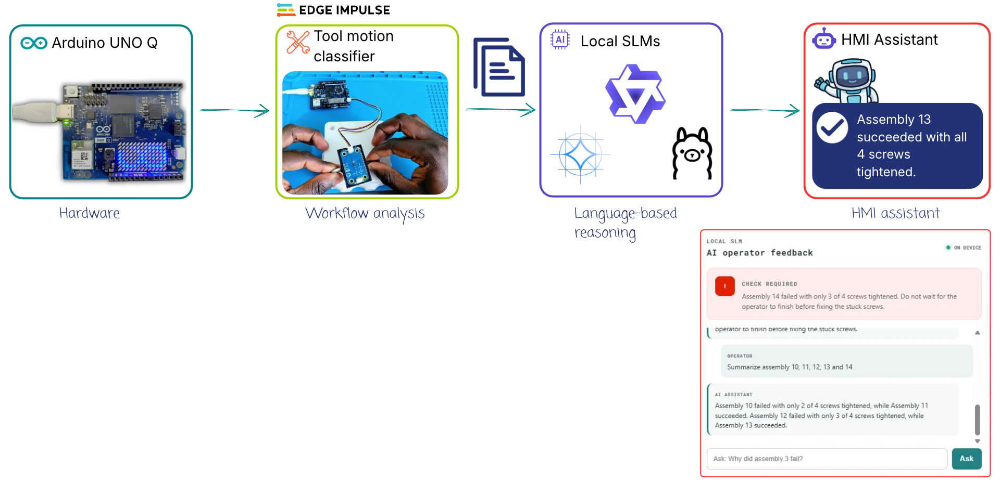

The system is built in four layers:

| Layer | Runs on | Job |
| --- | --- | --- |
| Perception | STM32 microcontroller | Classify the tool motion as `idle`, `moving` or `tightening` |
| Workflow logic | Python on the UNO Q's Linux side | Monitors screws tightening and decide whether an assembly is good or defective |
| Explanation | Local Small Language Model (Qwen 3.5 0.8B) | Writes short feedback and answer operator questions |
| HMI | Web UI in the browser | Shows assembly progress, feedback and chat box |

The language model never decides whether an assembly passed or failed. That decision is made by the state machine, so it is predictable and easy to verify.

## Hardware and Software Requirements

### Hardware

- [Arduino® UNO Q](https://store.arduino.cc/products/uno-q): either the 2GB or 4GB variant.
- [Modulino™ Movement](https://store.arduino.cc/products/modulino-movement) and a Qwiic cable
- USB-C® cable
- Personal computer with internet access
- 3D printed [tool support](https://github.com/SolomonGithu/industrial-hmi-copilot/blob/main/CAD-designs/Modulino-on-allen-support.stl) for the Modulino™ Movement module
- 3D printed [flat end socket](https://github.com/SolomonGithu/industrial-hmi-copilot/blob/main/CAD-designs/Screw-end.stl) for the tool
- An Allen key, and a unit with four Phillips head screws to tighten (I used an electrical box)

### Software

- [Edge Impulse Studio](https://edgeimp.com/community26) and the [Edge Impulse CLI](https://docs.edgeimpulse.com/tools/clis/edge-impulse-cli)
- [Arduino App Lab](https://docs.arduino.cc/software/app-lab/) and the [Arduino IDE](https://docs.arduino.cc/tutorials/uno-q/user-manual/#arduino-ide-beta)
- Small Language Models available locally through App Lab: Qwen, Llama, Gemma
- Git and an SSH client

Qwen 3.5 0.8B was used for this project.

## Step 1: Assemble the tool support

The setup process for this demonstration is simple. First download this [CAD design](https://github.com/SolomonGithu/industrial-hmi-copilot/blob/main/CAD-designs/Modulino-on-allen-support.stl) and 3D print it. This is a simple holder that carries the Modulino™ Movement module and has a slot into which a tool can be inserted. In my case, I used an Allen key as the tightening tool and because my electrical box had Phillips cross head screws, I added a simple 3D printed [flat end socket](https://github.com/SolomonGithu/industrial-hmi-copilot/blob/main/CAD-designs/Screw-end.stl) that fits onto one end of the Allen key and lets it grip the Phillips screws.

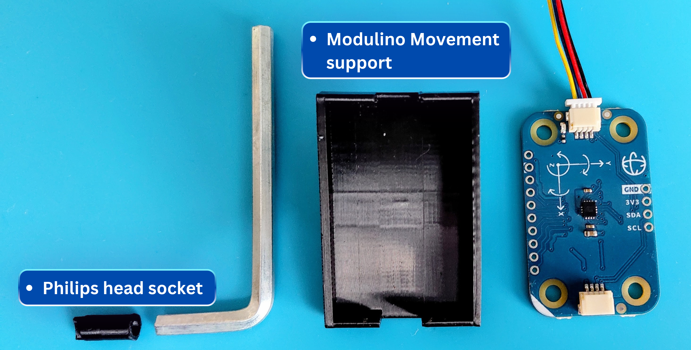

Place the modulino module in the carrier and attach your Allen key with the hole at the bottom. Afterwards, attach the Phillips socket to the free end of your Allen key. Finally, connect the modulino module to a UNO Q board with a Qwiic cable.

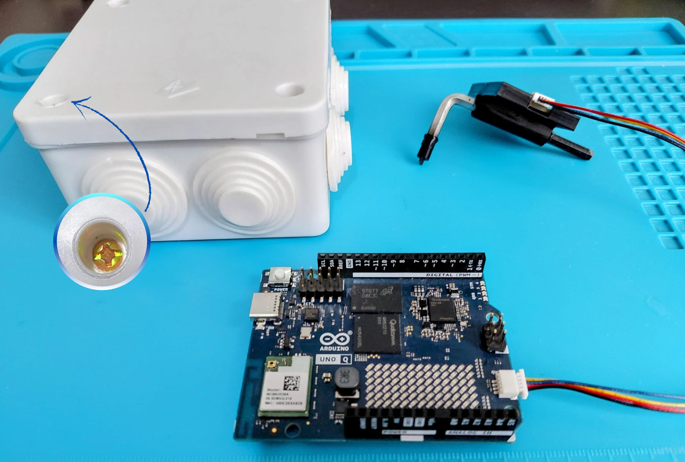


## Step 2: Set up your UNO Q

Before working with the UNO Q for the first time, we need to set up its Linux system through the App Lab. Arduino has documented the necessary steps in the [user manual](https://docs.arduino.cc/tutorials/uno-q/user-manual/).

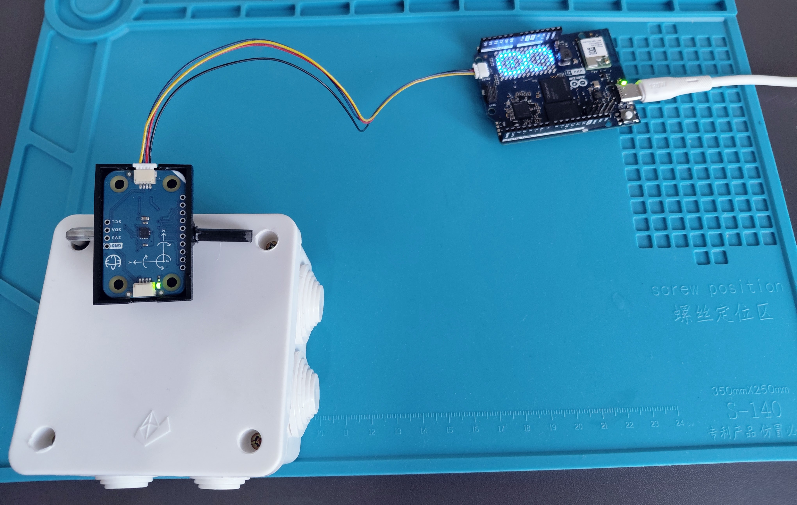

## Step 3: Train a motion classification model with Edge Impulse

### 3.1: Collect tool motion data

Upload this [sketch](https://github.com/SolomonGithu/industrial-hmi-copilot/blob/main/Arduino-sketches/UNO_Q_modulino_movement_capture/UNO_Q_modulino_movement_capture.ino) to your UNO Q. It reads accelerometer values and prints the three axes (X, Y, Z) to Serial. You can use App Lab or the [Arduino IDE](https://docs.arduino.cc/tutorials/uno-q/user-manual/#arduino-ide-beta) to upload the sketch to the STM32 brain of your UNO Q.

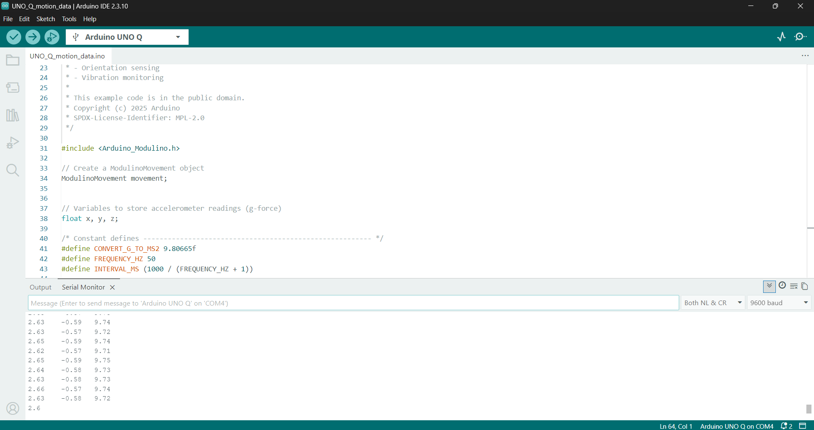

After uploading the sketch, ensure that your UNO Q is connected to your computer with a USB cable and there are no Serial Monitors holding the UNO's COM port. Then install and/or start the [Edge Impulse CLI](https://docs.edgeimpulse.com/tools/clis/edge-impulse-cli) in a terminal. This is a highly advanced software that is used to control local devices, act as a proxy to synchronize data for devices that don't have an internet connection, and to upload and convert local files. In this project, we will use the [edge-impulse-data-forwarder](https://docs.edgeimpulse.com/tools/clis/edge-impulse-cli/data-forwarder) tool of the CLI to capture Serial data from the UNO Q board and automatically upload them to an Edge Impulse project. Head to [Edge Impulse Studio](https://edgeimp.com/community26) and create a new project. Once the project has been created, ensure your PC has internet access and run the command below on a CLI to start the data forwarder:
```
edge-impulse-data-forwarder
```

You will be requested to enter your Edge Impulse account credentials and select the project that should receive the accelerometer data. Enter `Ax, Ay, Az` as the sensor axes.

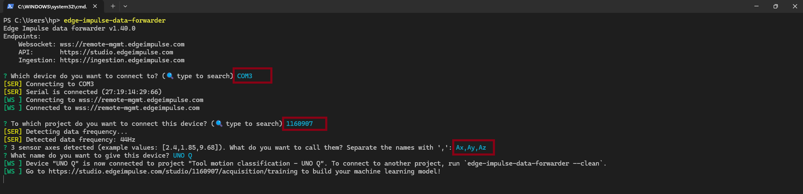

When we go to 'Data acquisition' in our Edge Impulse project, we will see that the UNO Q board has been connected.

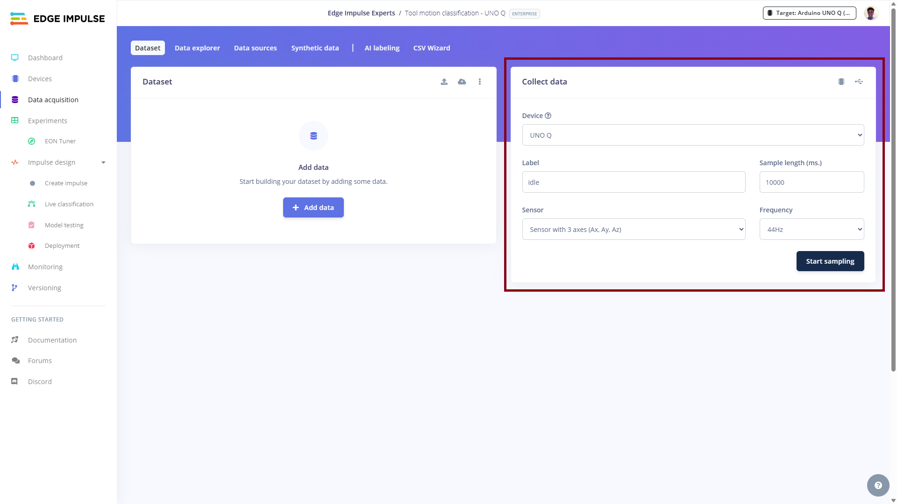

We can now start sampling motion data about assembly activities. In the 'Collect data' section, we need to first set the label for the class that we are collecting data. We can also configure the duration of sampling data using the 'Sample length (ms.)' setting. I used 10-second samples and planned three classes: idle, tightening and moving. Click 'Start sampling' and the Edge Impulse Studio will automatically instruct the data forwarder running on your PC to start sampling IMU data via Serial and upload them to the project.

I first started with the idle tool state. This is simple since there is no motion that we are carrying out. However, it is important to note that for a richer dataset ensure the modulino movement module is oriented differently when sampling. The image below shows raw accelerometer data for different orientations of the idling tool.

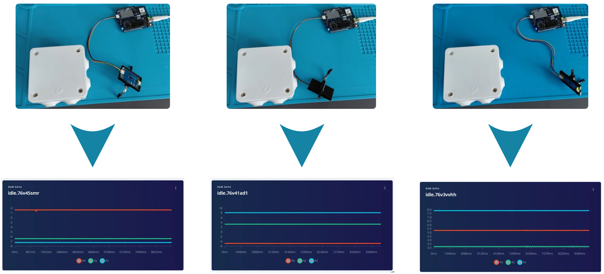

Next I sampled motion data of screw tightening activity. Below is a clip of the tightening action and graphed IMU data.

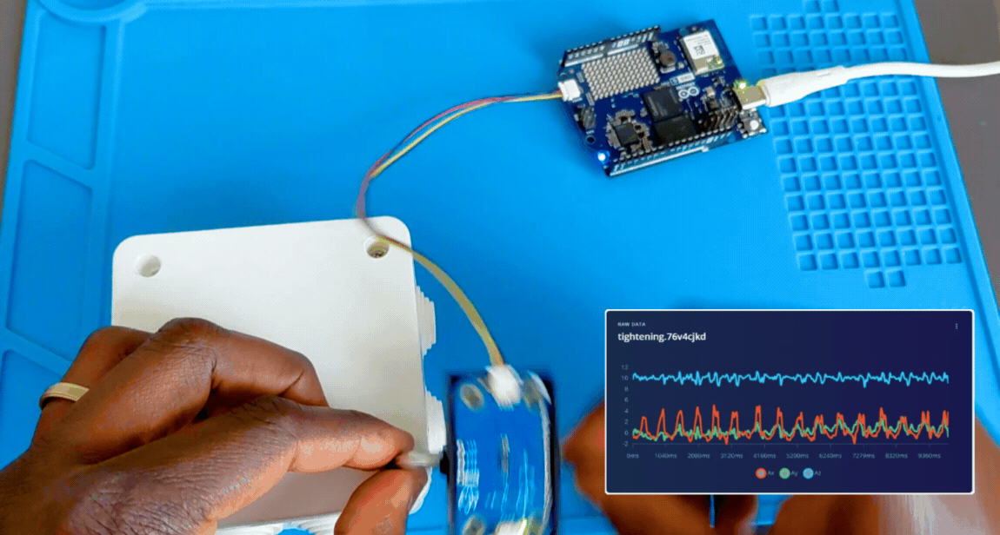

Finally, I recorded tool movements such as carrying the tool from the table to the assembly, or from one screw hole to the next.

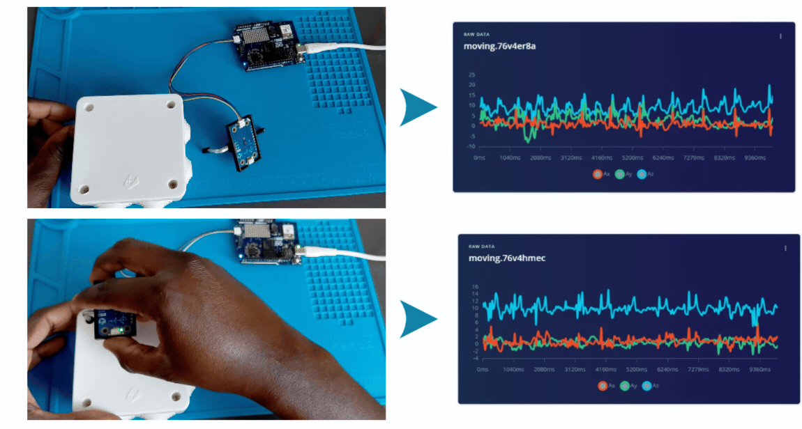

Looking at the IMU data, we can observe that each motion has a different pattern. This tells us that an AI model is capable of analyzing the trends and learning the motions. In total, I collected 5.5 minutes of data and splitting it into 1-second segments gave me 330 data points. To split the samples, click the three-dot vertical menu on each sample then choose 'Split Sample'. 

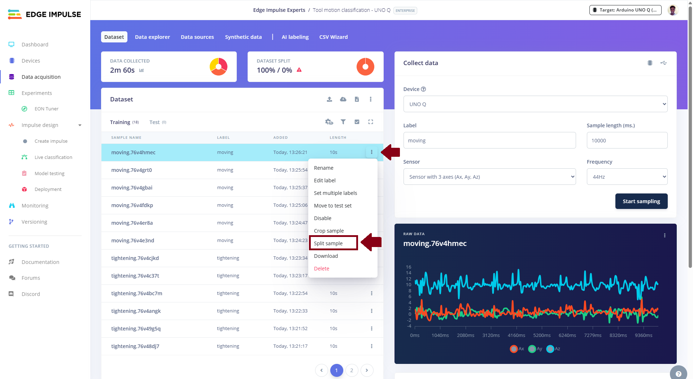

Click '+Add Segment', then click the graph to create a segment. Repeat this until the whole graph has been segmented. Finally, click 'Split' and you will see 1 second samples (or as configured by 'Set segment length (ms.)').

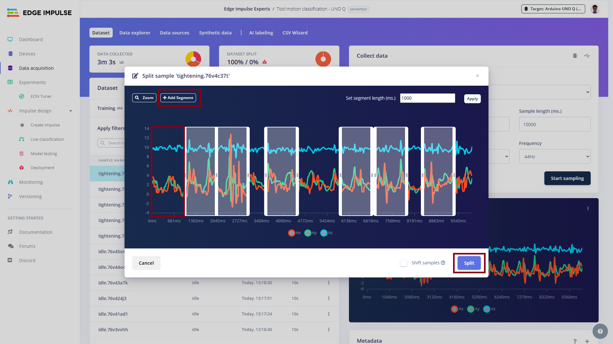

The last data preparation step is to split our dataset for training and testing. A popular rule is 80/20 split whereby 80% of the dataset is used for model training while 20% is used for model testing. In Edge Impulse Studio project, we can click the red triangle with exclamation mark (as shown in the image below) and this will open an interface that suggests splitting our dataset. Follow the steps on the interface to confirm the split operation.

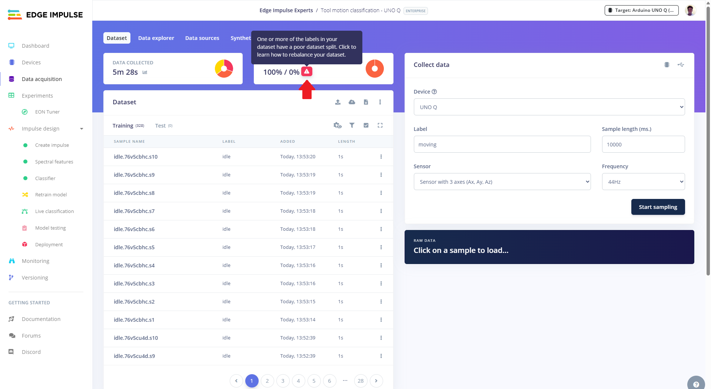

### 3.2: Train a motion classifier

Before training the motion classifier, we need to set up an [Impulse](https://docs.edgeimpulse.com/docs/edge-impulse-studio/impulse-design-and-experiments) which is a configuration that defines the input data type, pre-processing algorithm, and the Machine Learning model. 

Click 'Create Impulse' and choose your processing settings. I set the input data to a window size of 1000ms (1 second) and a window increase of 500ms. The sampling frequency of 44Hz is automatically set by the UNO Q's connection. I used Spectral Analysis for feature extraction because the algorithm is great for analyzing repetitive motion, such as data from accelerometers. It extracts the frequency and power characteristics of a signal over time. Save the impulse configuration and open the Spectral features section.

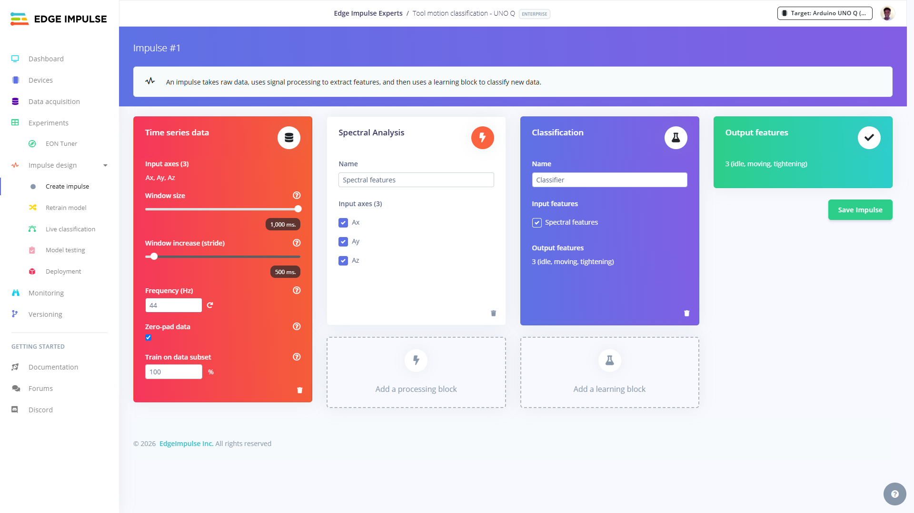

There, we extract features for every sample and they are plotted. A good rule is that you want to see clusters for each class and this should be visually detectable as shown below.

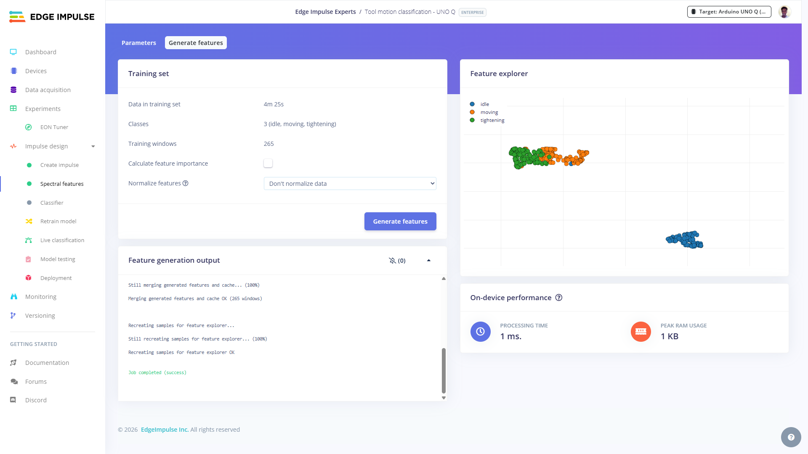

We can now train a neural network, an algorithm that is inspired by the brain and is great for recognizing patterns. After various experiments with the neural network settings, I trained the model for 50 epochs and enabled the learned optimizer for updating model parameters based on gradients and history. The resulting model had an accuracy of 100%, based on the training data.

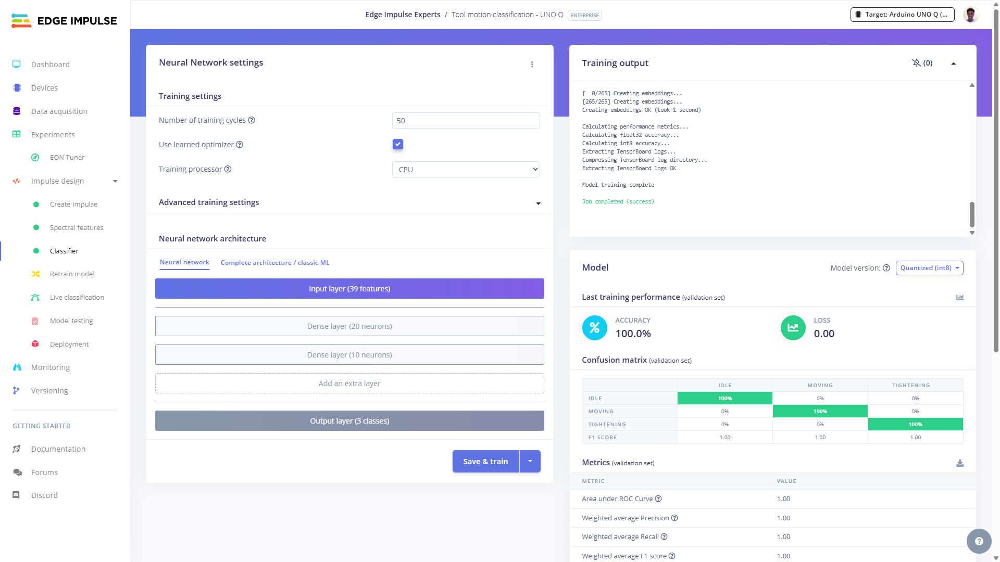

Testing the model on unseen data showed good results with 100% accuracy. This was good enough for me to proceed with deploying the model to an Arduino UNO Q. 

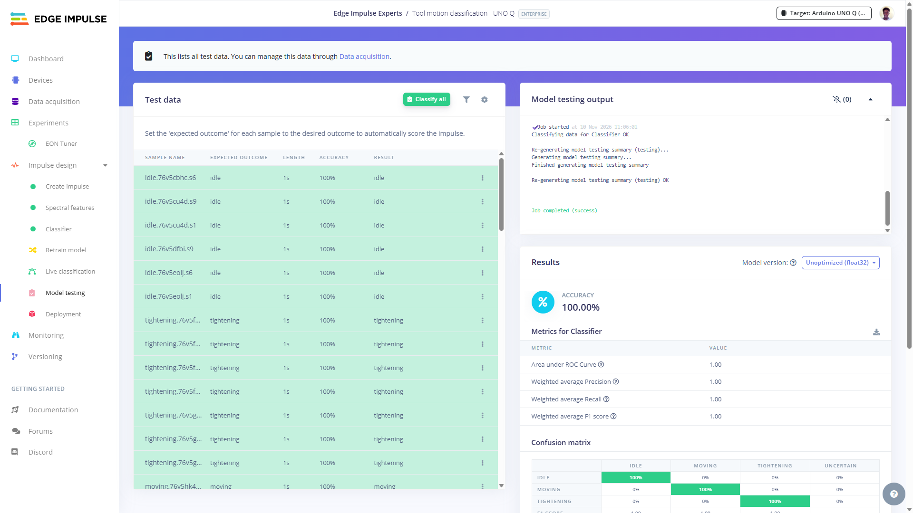

You can explore my resulting project here: [Tool motion classification - UNO Q](https://studio.edgeimpulse.com/public/1160907/latest).

### 3.3: Deploy motion classifier to UNO Q

We will deploy the model as an [Arduino library](https://docs.edgeimpulse.com/docs/run-inference/arduino-library) - a single package containing all the steps for sampling IMU data for 1 second, processing the data and feeding the features to the classifier. You can include this library in your own sketches to run the impulse locally on microcontrollers such as the STM32 on the UNO Q. Technically no programming is needed to deploy the Impulse as the Edge Impulse platform generates all the required source code and example sketches as well. Awesome!

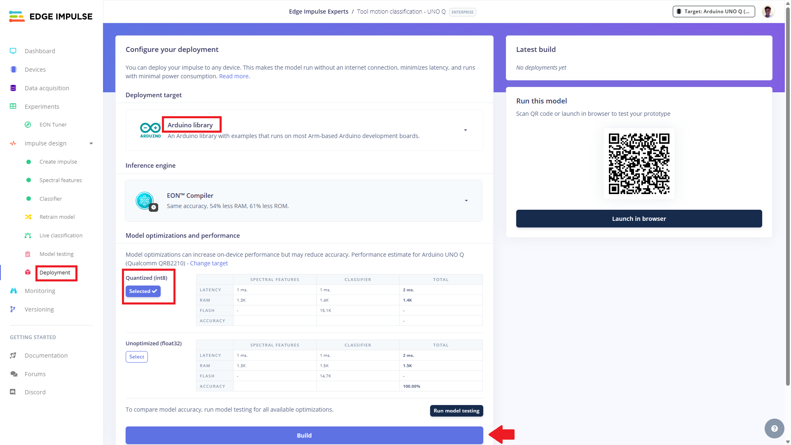

Once the library is built, it will be downloaded to your PC as a zip file. Add it to the Arduino IDE, then open the `model_metadata.h` file in the Arduino library folder (Tool_motion_classification_-_UNO_Q_inferencing\src\model-parameters) and change the value of `EI_CLASSIFIER_SENSOR` from `EI_CLASSIFIER_SENSOR_FUSION` to `EI_CLASSIFIER_SENSOR_ACCELEROMETER`.

Once the file has been updated, upload this example [sketch](https://github.com/SolomonGithu/industrial-hmi-copilot/tree/main/Arduino-sketches/UNO_Q_EI_motion_classification) to the STM32 MCU for continuous motion classification. Open a Serial Monitor and you should see the model's predictions being logged.

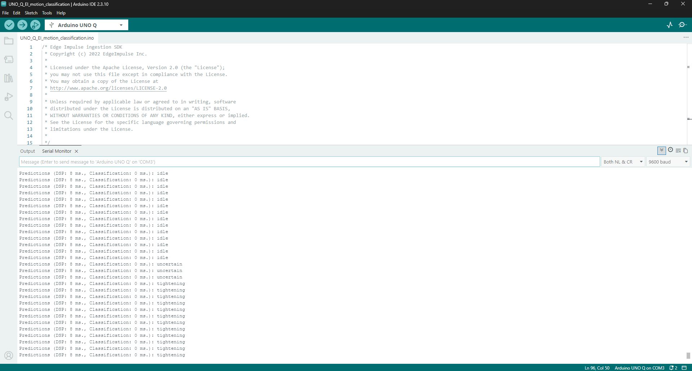

For the HMI application, we will use this [sketch](https://github.com/SolomonGithu/industrial-hmi-copilot/tree/main/Arduino-sketches/UNO_Q_EI_motion_classification_Linux). It uses the [Router bridge](https://docs.arduino.cc/tutorials/uno-q/routerbridge-multilanguage/) to pass motion classifications to the Linux brain, where they are further analyzed and explained by the Qwen language model. After verifying the basic motion classification with the previous sketch, upload this router enabled sketch to the STM32.

## Step 4: Download the HMI Copilot

Installing the HMI application on an Arduino UNO Q is simple. SSH into the board and clone this GitHub repository into the `/home/arduino/ArduinoApps/` directory.
```
git clone https://github.com/SolomonGithu/industrial-hmi-copilot.git
```
Once the repo has been cloned, you should see the project in the 'Apps' section of App Lab.

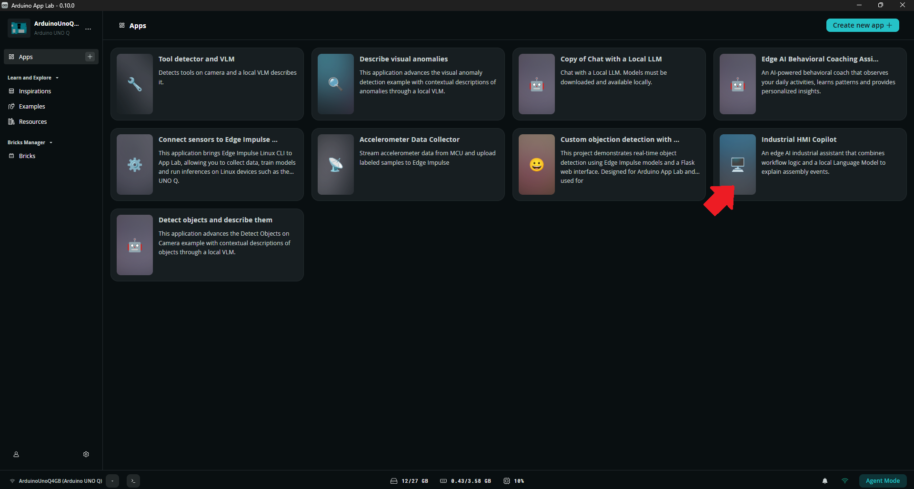

## Step 5: Install a Small Language Model

Recall our pipeline had two cascaded models: a perception model (motion classification), and a Small Language Model. Technically, developing the first model takes the most time because SLMs are already trained for general language based tasks.

Open the HMI Copilot project in App Lab, click the 'Large Language Model (LLM)' brick and navigate to the 'AI models' tab. Download and select one of the available models. I used Qwen 3.5 0.8B because it is relatively small and can generate a response more quickly. Other supported models such as Gemma 3 1B can be used depending on your hardware and use case. 

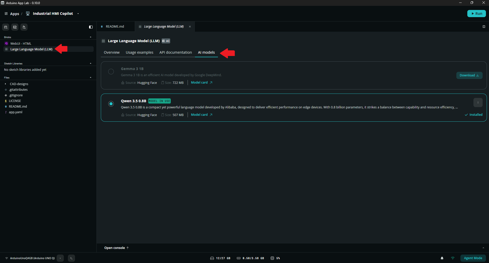

## Step 6: Run the HMI Copilot

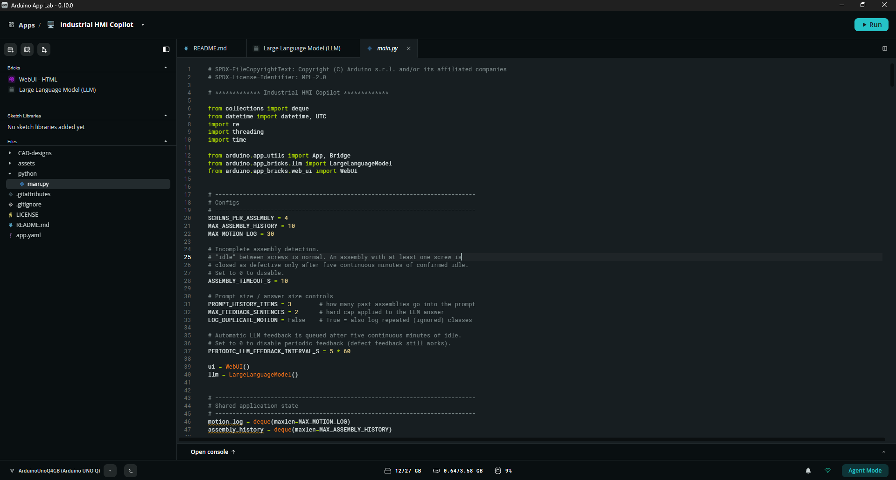

Launch the HMI Copilot by clicking the 'Run' button. Running the application for the first time may take some seconds since the system needs to download the necessary Docker images. Once this is finished the application container will be started and the Web UI will automatically open in a browser. You can also open the Web UI manually in a browser by setting URL to the local IP address of your Arduino UNO Q and port 7000. 

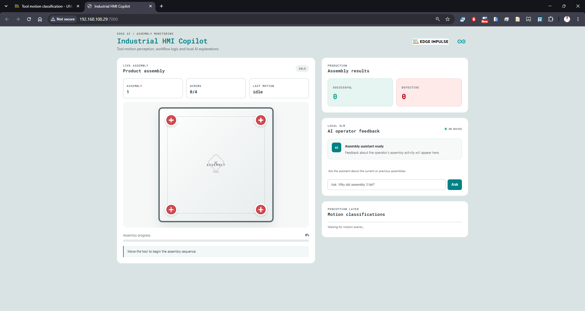

**Workflow visualizer**: the first section of the Web UI-based HMI is a workflow visualizer. It shows assembly progress in real time: the tool moving to a screw, tightening it, and putting the tool down (idle). An assembly is marked as successful when 4 screws are tightened. 

A state machine (run by [main.py](https://github.com/SolomonGithu/industrial-hmi-copilot/blob/main/python/main.py)) handles the realities of assembly workflow. When an operator picks the next electrical box for assembly, the tool goes idle, and the state machine infers that the previous assembly work has been finished and a new one is about to start. The idea is that sometimes an operator may tighten say 2 out of 4 screws and the unit will be recorded as defective.

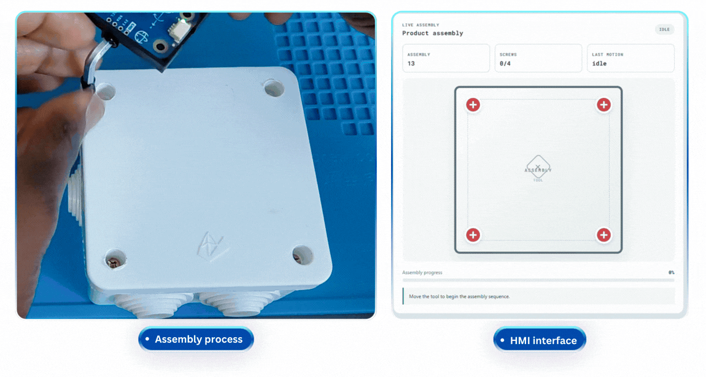

**Assembly counters**: the interface keeps running counts of both successful and defective assemblies. The Qwen language model is run periodically (interval set by the `PERIODIC_LLM_FEEDBACK_INTERVAL_S` variable in [main.py](https://github.com/SolomonGithu/industrial-hmi-copilot/blob/main/python/main.py)) to notify the operator about defective assemblies and to describe how the last assembly went.

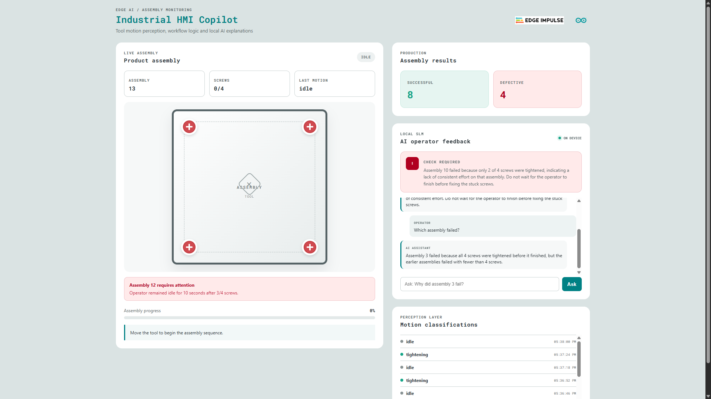

**Copilot chat**: a chat box lets the operator ask the language model questions about the assembly. In the example below, I asked the model to summarize various assemblies and it gave an impressive response. The model however failed to respond about assembly 14 and this is one of the limitations of small language models. Sometimes they hallucinate, or do not follow instructions well because they are built with limited training data and a small model size.

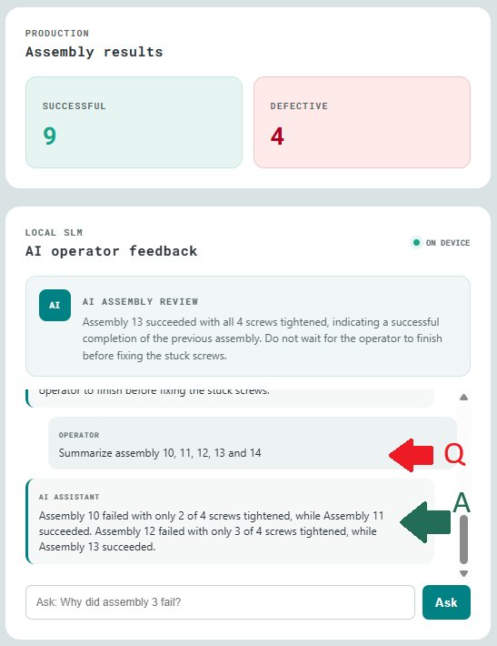

### Test it

1. **Good assembly:** tighten four screws, resting the tool between them, then put the tool down. The 'Successful' counter goes up by one.
2. **Defective assembly:** tighten a number screws, say 3 out of 4, then put the tool down. After sometime the 'Defective' counter goes up and the language model writes a warning.
3. **Ask the copilot:** ask the language model something like "Why did the last assembly fail?" in the chat box. The answer should say that only X of 4 screws were tightened.

### Settings you can change

The settings are defined at the top of [main.py](https://github.com/SolomonGithu/industrial-hmi-copilot/blob/main/python/main.py). Restart the app after changing them.

| Variable | What it does | Default |
| --- | --- | --- |
| `SCREWS_PER_ASSEMBLY` | Tightenings needed for a good assembly | 4 |
| `ASSEMBLY_TIMEOUT_S` | Seconds without motion before an unfinished assembly is marked defective. Set it longer than the longest normal pause between two screws. 0 turns it off | 10 |
| `PERIODIC_LLM_FEEDBACK_INTERVAL_S` | Seconds between automatic summaries from the language model. Feedback after a defective assembly always runs | 300 |
| `PROMPT_HISTORY_ITEMS` | Finished assemblies included in the prompt. More helps questions about the past but slows the answer | 3 |
| `MAX_FEEDBACK_SENTENCES` | Longest answer shown to the operator, in sentences | 2 |
| `LOG_DUPLICATE_MOTION` | Also log repeated motion classes that are ignored | False |